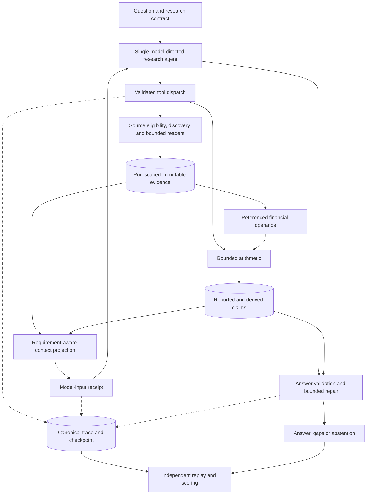

# Finance harness improvement specification

Version: proposal v1 · 2026-11-16

Status: implementation specification and continuous-improvement operating contract.
Requirements below are intended behavior, not claims that the features exist.
The active goal is in **Research finance agent harnesses**. Finishing this document
or one experiment does not complete that ongoing goal.

## 1. Objective and initial scope

Improve the rate of financially correct, evidence-supported, complete research
answers under explicit execution and spending budgets. Every change must either
repair a reproducible correctness defect, enable a necessary evaluation boundary,
or test a stated quality/efficiency hypothesis against a frozen baseline.

The first vertical slice answers numerical extraction, two-period comparison,
margin, ratio, growth, and missing-evidence questions using a supplied, pinned
company-document packet. Supplying documents is the initial implementation
default, not a claim that the user rejected autonomous source discovery. Broader
filing discovery can follow after source selection and historical availability
are independently testable. The model still chooses searches, reads, calculations,
and stopping; workflow instructions must not script benchmark-specific answers.

Retain Python, LangChain, LangGraph, OpenRouter, and the single research agent.
Development subagents are engineering/review collaborators; they do not imply
a production multi-agent architecture. Retain the selected model identifier
unless a separately declared model comparison changes it.

### In scope

- Versioned model-input receipts and checkpoint compatibility.
- Immutable evidence references and bounded deterministic financial arithmetic.
- Coordinated table/fact discovery, reading, claim validation, and replay.
- Context retention driven by active research requirements.
- Narrow reusable workflow instructions and progress feedback.
- Independent, staged evaluation and a repeated improvement ledger.
- Budgeted finalization and explicit incomplete/abstention outcomes.

### Deferred

Browser/API implementation, Excel/Office.js, workbook writes, market trading,
portfolio actions, arbitrary Python execution, unrestricted network connectors,
large valuation suites, autonomous analyst teams, and training on evaluation
feedback. Deferred tool schemas are optional only after a measured catalog-size
problem exists. Do not change framework simply to obtain these capabilities.

## 2. Baseline and inherited decisions

Baseline documentation commit: `49a5ddb`; freeze each implementation experiment
against its own explicit runtime commit. The checkout includes unrelated,
uncommitted XBRL assessment work. It is not part of this specification's baseline
implementation and must not be silently incorporated into an experiment.

| Area | Verified current boundary | Required change |
| --- | --- | --- |
| Default tools | `sources.TOOL_SCHEMAS`: search and line-based read | Introduce additional capabilities behind explicit versioned profiles |
| Runtime | `graph.run_graph`: bounded loop, checkpointing, finalization/repair | Bind all behavior identities and preserve synthesis resources |
| Model context | `context.project_messages`: 32K serialized tool-result characters, recency policy | Record the actual projection and test requirement-based retention |
| Answers | `model.validate_answer`: exact legacy fields and quote checks | Add a separate v2 claim/derivation contract without mutating v1 |
| Evidence | `Sources` read ledger, native extraction, pinned artifacts | Share run-scoped typed evidence identities across reader kinds |
| Tables and facts | Experimental `TableSources`, `FactReader`, typed XBRL export | Integrate discovery, delivery, validation, and replay together |
| Temporal controls | `source_availability.availability`; exact-artifact checks in fact reader | Enforce consistently for any new historical tool profile |
| Evaluation | Replay, component diagnostics, external tool-free runners | Separate full-agent runner after source acceptance; keep old scores |

Current exact-ID delivery is not question-driven retrieval. Schema-valid XBRL is
not verified financial sufficiency. Quote presence is not entailment. Reduced
response characters are not automatically reduced billed tokens or higher
answer accuracy. These distinctions are release-report requirements.

Relevant chat context inspected on 2026-11-16:

- **Improve finance evaluation harness** (`01a1e409-ea16-7fe0-bef7-63951e284570`):
  previous loop paused; eight-case assessment unfinished. Keep financial-role
  delivery, visible-source controls, and strict packet coverage separate.
- **Write UI agent handoff** (`01a1e62d-6b3e-7d91-a80d-4e2b7568c8c9`): preserve
  legacy answers and reports; execution checkpoints are not chat sessions;
  reconnect, cancellation, concurrent sessions, and server deadlines need their
  own work. Do not claim these are solved by this spec.
- **Evaluate OCR for source ingestion** (`01a1c30c-3a5d-7811-85bd-725b022bed8a`):
  preserve reported versus resolved XBRL context, namespace identity, explicit
  versus defaulted dimensions, residual qualifiers, and original occurrences.

This chat's new goal does not unpause or take ownership of another chat's drafts.
The lead coordinates ownership before touching shared implementation files.

## 3. Architecture and trust boundaries

These are logical boundaries inside the existing application, not required
microservices. Runtime may access public task inputs and eligible source evidence.
It must not access reference answers, gold locations, reviewer requirements,
judge feedback, or outcome-assisted retrieval hints. The evaluator reads frozen
runtime artifacts after execution and cannot improve a live response.

Document text, tool content, and external workflow files are data, not authority
to change tool permissions, budgets, or instructions. Calculation execution uses
an allowlisted operation schema, never eval, shell, or model-written Python.

## 4. Versioned contracts

### 4.1 Research contract

An optional explicit v2 run contract contains `question`, `source_scope`,
`entity_scope`, `requested_periods`, `as_of`, `workflow_version`, and `limits`.
Unspecified financial meaning remains unknown; the runtime must not silently
invent accounting basis, fiscal/calendar correspondence, or consolidated scope.
The model may record its interpretation and unresolved questions, but evaluator
requirements are never copied into this contract.

Initially, source scope is the exact supplied manifest and content hashes.
An as-of run uses timezone-aware cutoff values and the existing conservative
artifact-availability semantics. Missing availability evidence is not permission
to use an artifact in a historical condition. Nonhistorical runs retain their
distinct policy and must not be labeled point-in-time evaluations.

### 4.2 Model-input receipt v1

Record a receipt for every attempted provider request, including rejected or
failed attempts when request construction completed. The receipt contains:

| Field | Meaning |
| --- | --- |
| `receipt_version`, `run_id`, `attempt_id` | Stable identity and schema |
| `adapter_version`, `projection_version` | Request construction and retention policy |
| `instructions_sha256`, `tool_schema_sha256`, `workflow_sha256` | Exact effective behavior configuration |
| `canonical_history_sha256` | Parent history before projection |
| `retained_call_ids`, `omitted_call_ids` | Complete, disjoint projection inventory |
| `evidence_ids` | Typed evidence present in this request once the H2 registry exists |
| `request_sha256` | Canonical application request after projection and provider-message mapping |
| `input_characters`, `tool_result_characters`, `final_only` | Diagnostics and request mode |

Define canonical serialization once: UTF-8, sorted object keys, deterministic
separators, ordered arrays, nonfinite numbers forbidden. Hash the effective
instructions/messages/tools/generation controls, excluding credentials and
transport secrets. Preserve or reconstruct the canonical request bytes from
immutable trace artifacts; the digest alone does not establish what was sent.
Distinguish application request from provider-side tokenization or internal SDK
wire transformations. No provider attestation is implied.

H1 precedes the typed evidence registry. It emits `evidence_inventory_kind:
legacy_read_fragments`, `evidence_ids: []`, and immutable legacy references
containing read call ID, result hash, source ID and returned line range; the empty
typed inventory means not applicable, not no evidence. H2 uses
`evidence_inventory_kind: typed_records`. H1 adds no model-visible IDs or text.
Retained/omitted call IDs partition tool outputs present in canonical history;
unanswered calls have no output to classify. Skipped/error outputs present in
history are classified as outputs but never count as factual evidence.

Projection occurs exactly once per request. Cost estimation and provider dispatch
must consume that same projected object. Emit the receipt before external dispatch
and bind the result or failure to the attempt ID. Never turn optional logging
into unconditional disk writes; preserve existing explicit trace persistence.

Acceptance: retained/omitted inventory is exact; call/output pairing survives;
both synthesis and repair have receipts; reconstruction matches hashes; tampered
receipts fail; credentials never appear; recording receipts does not change the
projected messages, generation settings, reservations, or provider call count.

### 4.3 Evidence record v1

An evidence record binds `evidence_id`, `kind`, `source_id`, original/extracted
hashes, reader/version, locator, read receipt, and exact returned content. Kinds
initially include `text_span`, `table_cell_group`, and `xbrl_occurrence`.
IDs are run-scoped references bound to content; they cannot refer to evidence
from another run, unapproved source, or an unread search result.

Financial attributes include value lexical form, normalized decimal when valid,
unit/currency/scale, entity, metric identity, period start/end or instant, fiscal
label, accounting basis, actual/guidance status, dimensional scope, and explicit
unknowns. Each normalized attribute records its supporting evidence and whether
it was parser-produced or model-proposed. A model assertion is not an independent
semantic verification. Preserve source representation alongside normalization.

XBRL records retain occurrence identity, concept namespace/local name, context,
unit, original fragments, duplicates/quarantine, and reported versus resolved
dimensions. Do not erase non-dimensional qualifiers or silently merge conflicting
duplicates. Source fragments, context/unit fragments, table headers, peer facts,
and taxonomy defaults are separate evidence roles; delivery of one does not imply
delivery of all others.

Deferred/chunked results become eligible evidence only after complete reconstruction
and inventory/hash verification. Failed, partial, or quarantined results remain
inspectable diagnostics but cannot be used as accepted numeric operands.

### 4.4 Calculation record v1

Proposed model-facing capability: `calculate(operation, operand_refs, output_unit,
rounding_policy)`. Final names may change before schema freeze. Operands reference
accepted evidence or earlier calculation records; raw unexplained numbers are
not factual operands. Operation-defined constants such as percentage scaling are
versioned semantics, not additional source facts. Assumptions, if later enabled,
must be a distinct attributed operand kind and cannot be graded as reported facts.

Initial operations: add, subtract, divide/ratio, margin percent, relative growth,
and percentage-point difference. Use Decimal input from strings, finite values
only, precision 34 and explicit half-even rounding. Preserve the precision-limited
result before display rounding and report inexact/rounded flags; do not call it
infinitely precise. Source measurement precision remains a separate attribute.
Initial bounds: at most 32 operands for sums, two for binary operations, 128 input
digits, parsed exponent and adjusted exponent each within -100 to 100, chain depth
16, and 12,000 serialized response characters. Reject booleans, malformed decimal
strings, nonfinite values and results outside bounds atomically. Freeze these
limits with the calculation policy; changes require a new policy version.

The coefficient-digit bound applies to the lexical coefficient before normalization;
validate length and exponent syntax before Decimal construction. Output coefficient
and exponent bounds use the same maximums independently of arithmetic precision.
Overflow, invalid operation or out-of-range exponent rejects rather than clamps.
Accepted rounding request is `{decimal_places: integer 0..12}` only; rounding mode
is fixed by the versioned policy. No caller-selected rounding mode is permitted.

| Operation | Arity and ordered semantics | Output |
| --- | --- | --- |
| `add` | 2..32 operands, exact declared order | Common compatible unit |
| `subtract` | `[current, comparison]`, current minus comparison | Common compatible unit |
| `ratio` | `[numerator, denominator]`, numerator / denominator | Dimensionless for compatible like units |
| `margin_percent` | `[profit, revenue]`, 100 × profit / revenue | Percent |
| `relative_growth_percent` | `[current, baseline]`, 100 × (current - baseline) / baseline; baseline positive | Percent |
| `percentage_point_difference` | `[current_rate, comparison_rate]`, current percent minus comparison percent | Percentage points |

Normalize declared power-of-ten scales into base units before compatible arithmetic,
preserving the source lexical value and the transformation record. Rate operands
declare `fraction` or `percent`; convert fractions by the fixed factor 100 for
percentage-point operations. Unknown scale or rate representation rejects.
`output_unit` is an assertion of the derived unit, not an arbitrary conversion
instruction; mismatches reject. Display-scale conversion is deferred in v1.

Rules:

- No currency conversion or fiscal-period conversion without a dedicated,
  source-backed transformation; these are not part of the initial calculator.
- Same-period ratios require compatible entity, scope, period and accounting
  basis. Two-period differences/growth explicitly allow the designated period
  difference while requiring comparable metrics and period types/durations.
- Division by zero and nil inputs produce typed errors. Nil is never zero.
- Percentage-point difference and relative percentage change are distinct
  operations with distinct units. Rate representation must be explicit.
- Relative growth initially requires a positive baseline. Zero/negative baseline
  conventions remain unsupported unless a later version defines them explicitly.
- Contradictory or unknown required scope prevents a verified calculation claim;
  the model may gather more evidence or explain the limitation.
- Reusing a calculation cannot create cycles, cross-run references, or unbounded
  depth. The controller counts arithmetic calls within the declared tool budget.

A result records operation/version, operand IDs and hashes, compatibility checks,
result value/unit, precision/rounding, and all upstream evidence IDs. Arithmetic
replay verifies the calculation; it does not certify the financial definition.

### 4.5 Answer v2 and legacy compatibility

Do not add fields to the exact-field v1 validator or silently reinterpret old
artifacts. Keep the default legacy profile replayable. Introduce an explicitly
selected v2 profile with an envelope containing `schema_version`,
`answer_status` (`answered`, `partial`, `abstained`), `answer`, `claims`, and
`unresolved_requirements`. Execution status (`completed`, `stopped`, `failed`,
`paused`) remains separate from answer completeness.

Each claim has a unique ID, kind (`reported`, `derived`, `qualitative`), value,
unit, period/scope metadata, evidence references, and a calculation reference
required for derived numeric claims. Numeric v2 values are finite decimal strings;
qualitative values are explicitly discriminated strings. Keep v1 numeric parsing
and grading unchanged. Each claimed source locator resolves against the run's
identified evidence, not newly fetched content. Evidence must appear in a preceding
submitted model request before supporting a model-produced claim; private tool
reconstruction alone is insufficient. Record prior delivery and final-synthesis
visibility separately. Under the proposed v2 finalization profile, final synthesis
must receive complete support groups or explicitly reread them within budget.
Never-delivered and previously-delivered-but-omitted evidence have distinct
rejection/diagnostic reasons.

After every final output, resolve all proposed claims, including claims introduced
for the first time in that output, against that attempt's receipt. Reject or repair
any claim whose complete support group was absent. Repair is a new final-synthesis
attempt with the same visibility rule. For typed chunks, the complete reconstructed
payload must be present as an identified assembled evidence result in that request;
earlier scattered chunks or private reconstruction cannot satisfy this rule.

Partial answers contain supported claims plus explicit unmet requests. Abstentions
contain no factual claim payload and explain scoped missing evidence. Do not treat
search failure as universal non-disclosure. Qualitative claims require support
but not artificial arithmetic records.

Validate every structured claim and reconcile financial numbers in narrative
against structured claims. Mechanical reconciliation catches omitted or altered
values but cannot prove entailment. Keep narrative-support review as a separate
score; dates, identifiers, and harmless nonfinancial numbers need explicit handling
to avoid false rejections. Old clients either request v1 or reject unsupported v2;
never silently flatten a partial v2 answer into legacy success.

## 5. Runtime and tool integration

### Tool profiles and dispatch

Keep the existing Sources adapter usable. Add the smallest explicit dispatch
boundary needed to route search/read, calculation, and opt-in typed readers.
Each profile declares schemas, versions, evidence registration behavior, limits,
and replay implementation. Avoid a general plugin framework in this increment.

Typed discovery must return candidate identities and uncertainty from question
and allowed source metadata, not gold fact IDs. Discovery results are navigation;
read operations establish evidence. Introduce a fact/table profile only when its
dispatcher, read ledger, answer validator, projection, checkpoint identity, and
grader agree. Do not bypass `run_prepared`'s full-agent guard: build a separately
verified runner and preserve the tool-free runner's condition contract.

### Context projection

Maintain canonical history separately from bounded model context. The active
requirement list is created from the user's question and model actions. States
are `unresolved`, `candidate`, `supported`, and `conflicting`; they are agent
working state, not evaluator truth. References used by pending calculations and
claims form complete support groups including applicable headers, units, periods,
definitions, and footnotes.

Proposed priority: current task/instructions and call pairing; active support
groups; latest navigation and errors; then other evidence within the same budget.
If mandatory groups cannot fit, explicitly reread smaller complete groups,
defer a subquestion, or terminate with a gap. Never clip a quote or mark a partial
group complete. Summaries are navigation aids, not substitute source evidence.
Keep this policy opt-in until paired evaluation supports promotion.

### Finalization and accounting

Reserve one synthesis opportunity and its conservatively estimated time/cost
headroom before further research. Estimate the final request using its projected
input and maximum allowed output; a remaining model turn alone is insufficient.
Repair remains bounded and shares the original run cap; a reserve is not new
spending authority. If the configured total cannot cover finalization, fail
preflight or stop explicitly without initiating avoidable paid research.

Record progress/repetition warnings without weakening hard limits. Every selected
task has one declared retry policy. An ambiguous paid attempt stops automatic
retry and retains its reservation until reconciled. Batch budgets include research,
judge calls, retries, and unresolved reservations. Persist aggregate accounting
before dispatch; a collection of per-run caps is not an aggregate cap.

### Checkpoint and transport compatibility

Extend identity with prompt, tool-schema, workflow, answer/evidence/calculation,
projection, reader policy, original/sidecar/metadata hashes, cutoff and effective
generation settings, alongside existing corpus/model/limits/rates. Record actual
adapter instructions and schemas rather than module globals when overrides exist.
Persist evidence, calculation, reconstruction and receipt ledgers in checkpoint state.
Reject incompatible resumes before external work. Old checkpoints retain a
legacy policy identity; do not guess new defaults for historical runs.

H1 introduces opt-in runtime profile `trace-receipts-v1` and checkpoint identity
`research-checkpoint-v3`. Default legacy runs keep the unchanged legacy resume
path. Old checkpoints cannot resume under v3; return an unsupported-version error
and require a new run. Completed legacy reports remain retrievable/exportable,
with receipt availability explicitly absent. Never manufacture historical receipts.

Only explicit safe tool-boundary pauses resume automatically. Completed runs stay
cached. The direct legacy engine and alternate adapters may remain legacy-only;
unsupported profiles fail before execution rather than pretending parity.
Server cancellation, reconnect, and session isolation remain UI/API responsibilities
with explicit shared contracts. Main-thread CLI deadline checks do not prove
equivalent behavior in a web worker.

## 6. Benchmark design and interpretation

### Suites and conditions

| Suite | Role | Conditions and limits |
| --- | --- | --- |
| Original 25 tasks | Legacy regression and separately authorized final assessment | Preserve 10 development / 15 heldout; no new tuning on reserved issuers |
| FinEval | Financial knowledge | Model-only choice scoring; not retrieval effectiveness |
| FinQA | Numeric reasoning | Supplied-evidence and later agent variants reported separately; adapted scalar score is not official program accuracy |
| TAT-QA | Table/text interpretation | Official EM/F1/scale plus distinct local semantic review |
| ConvFinQA | Multi-turn numeric reasoning | Reference-history versus actual-history; per-turn and all-turn conversation success |
| FinanceBench | Filing research | Source acceptance first; oracle evidence versus full-document agent separate |
| Custom company tasks | End-to-end feature acceptance | Frozen public inputs, answerable/ambiguous/missing-evidence cases, independent rubric |
| Finance Agent and newer suites | Later challenge | License/access, source/tool parity, overlap and cost review before import |

No aggregate score across incompatible datasets/conditions. If a dashboard needs
one view, show a vector of suite results and denominators rather than a weighted
score selected after observing outcomes.

### Evaluation layers

1. Source identity and extraction quality.
2. Candidate discovery and relevant evidence availability.
3. Bounded delivery and reconstruction.
4. Actual model-visible support at the relevant request.
5. Metric, unit, period, scope and operand selection.
6. Deterministic computation and rounding.
7. Final claim support, completeness, and abstention quality.
8. Operational completion, latency, token usage, estimated cost, and uncertainty.

Use separate labels for financial-role sufficiency, visible-source delivery and
strict full-packet delivery. A typed concept may satisfy a metric-identity role
without proving that a visible heading was delivered. Conversely, source markup
does not establish rendered visibility. Do not require optional detail unless
the question asks for it; alternate complete evidence sets must stand alone.

Primary proposed full-agent outcome: all required findings correct and
supported, required calculations replayable, no unsupported material additions,
and appropriate scoped abstention where necessary. Critical checks and numeric
tolerances are frozen before outputs. Report partial-credit separately, including
critical-failure gates. Valid abstention on unanswerable tasks can pass; abstaining
on answerable tasks cannot inflate quality by shrinking the denominator.

### Contamination and reference quality

Before source or case selection consult reservation.json, exposure-audit.json,
development exposure records, both original source manifests, research-exposure
addenda, cross-suite aliases, and other reservations. Keep all six reserved
issuers excluded from development tuning: Lockheed Martin, American Express,
Amazon, Microsoft, AMD, and Block/Square. Retain all six selected slots and
dispositions; Amazon and Microsoft have known prior issuer exposure. Public data
never establishes model non-exposure. Unresolved issuer identities remain explicit.

Do not open reserved question, gold, or source bodies until the applicable final
policy/protocol are frozen and access is authorized under that reservation.
The original 15-task holdout needs explicit final-assessment authorization.
This continuous-improvement goal does not grant new heldout access. Regression
replay of already saved artifacts is distinct from new issuer-specific tuning.

References remain evaluator-only. Freeze question interpretations before outcome
inspection. If an annotation is defective, preserve upstream gold and old scores,
record a content-bound issue, and report a separately versioned interpretation.
Unresolved references remain in selection accounting with score status unset;
report scorable and total selected denominators. Do not silently count them as
correct, discard them, or invent an adjusted official score.

Agent reviewers are not human finance experts. Calibrate any automated semantic
judge against blinded reviewed cases, record disagreement, and retain adjudication.
Without that calibration, label outcomes coding-agent-reviewed or provisional.

## 7. Continuous improvement protocol

Each cycle owns one failure class and one principal intervention. The cycle state
machine is `planned → frozen → executed → replay_verified → reviewed → decided`.
Terminal decisions are `promote`, `retain_opt_in`, `reject`, `inconclusive`, or
`invalid_protocol` (leakage, identity mismatch or another invalid comparison).
Infrastructure-only cycles may end after deterministic verification and must not
claim model-quality improvement.

Maintain a ranked failure backlog with the evidence artifact, affected stage,
reproduction, expected benefit, dependency, effort and cost. Prioritize integrity
and leakage, blocked evidence delivery, financial correctness, then efficiency.
Choose the highest-priority actionable item; do not continue a failed hypothesis
without new evidence. Source acceptance also binds document/issuer identity,
extraction warnings, sidecar hashes and relevant page/table/fact quarantine.
Acquisition failures remain selected failures, with no availability-based replacement.

### Required experiment manifest

Record cycle ID, parent baseline commit, candidate commit, hypothesis, changed
component, model/provider configuration, prompts/schemas/policies, dependency
lock, corpus/task/reference hashes, exposure selection audit, condition, full
task inventory, generation settings, tool/model/context/time limits, aggregate
cost cap, reservation treatment, attempt/repeat counts, run order, metrics,
tolerances, critical checks, judge identity, promotion rule, and stop rules.
Hash and commit it before inference. Any deviation gets a new experiment identity.

### Paired execution

Compare baseline and challenger on the same preselected inputs and matched budgets.
Interleave or randomize order with a recorded seed for live conditions. Fixed
temperature is not proof of deterministic generation. Freeze repetition counts
in advance; report all repeats and variability, never best-of results. Reuse a
saved baseline only when the protocol explicitly tests deterministic replay or
cached-tool behavior; stale provider runs are not a fresh live paired comparison.

Attempt status is explicit for every selected task: pending, completed, stopped,
failed, skipped-reference, or not-run-budget. Failed/stopped attempts remain in
task-completion reporting. No replacement with easier cases, hidden retries,
outcome-dependent early success stopping, or free extra searches for one branch.

Strict-success denominator is every preselected adjudicable case, including failed,
stopped, missing and not-run-budget cases as unsuccessful. Reference-unresolved
cases have null correctness and are separately counted in total-selected coverage.
Report both counts so budget exhaustion or abstention cannot inflate success by
shrinking the denominator. Critical checks also gate partial-credit scores; they
do not replace the requirement that strict success satisfies every required finding.

### Promotion rules

- Hard gate: zero introduced integrity, isolation, citation fabrication, temporal
  access, accounting, or checkpoint-compatibility violations in required tests.
- Correctness defect fix: adversarial reproduction fails before and passes after,
  relevant regression checks pass, and affected legacy replay is preserved or
  explicitly versioned. This supports a defect-fix claim, not broad accuracy.
- Quality challenger: positive paired change in strict supported task success,
  with uncertainty reported and no critical subgroup regression permitted by the
  frozen rule and acceptable cost/completion changes. Report paired wins/losses/ties
  and uncertainty clustered by issuer, source report or conversation as appropriate;
  related questions and repeats are not independent samples. A default promotion
  needs fresh confirmation beyond exposed tuning
  cases. Small pilots remain opt-in/inconclusive, even with a favorable point estimate.
- Efficiency challenger: predefined cost/latency reduction with predefined quality
  noninferiority margin; both require measured results. Character savings alone
  support only a response-size claim. Freeze margins/sample plan before execution.
- Repeated candidate searches require a declared comparison family and statistical
  treatment or a fresh confirmation cohort. Never keep testing a validation set
  until a candidate happens to pass.

For confirmatory quality trials, preregister a paired interval/test and a 95%
confidence criterion showing improvement; determine sample size from the desired
detectable effect before results. If resources cannot support that design, publish
descriptive counts/intervals and retain the candidate experimentally. Do not invent
a universal accuracy threshold or silently treat statistical uncertainty as success.

After a validation cohort is opened, log exposure; it cannot remain a repeatedly
untouched confirmation set. New confirmation selection must be prospective and
must not rewrite any existing reservation. A rejected change remains documented.

### Resource and stopping rules

The standing goal authorizes useful autonomous development, not unlimited spending.
Latest historical ledger: $1.00 aggregate authorization, $0.4814193 conservatively
recorded, $0.5185807 nominal remainder; the account was configured with a $1/day
limit. These are historical figures, not a current balance. Reconcile all run
ledgers, uncertain attempts, current provider pricing and account usage before
any paid batch. Stop paid work if the reconciliation is unavailable, inconsistent,
or insufficient; continue useful offline design, tests, replay, and reporting.

Stop an experiment on integrity violation, leakage, unresolved billing, or declared
resource exhaustion, preserving all records. If a hypothesis repeatedly fails,
close it and choose another measured bottleneck rather than adding mechanisms
without evidence. Respect explicit user pauses. The goal stays active across
ordinary completed cycles; report a real dependency when further useful work
cannot continue rather than claiming completion or silently resetting budgets.

## 8. Implementation increments and acceptance

| Increment | Deliverable | Required acceptance | Default behavior |
| --- | --- | --- | --- |
| H0 | Spec, ownership ledger, version inventory | Independent architecture/eval review; documented baseline | Unchanged |
| H1 | Model-input receipts and identity hashes | Exact projection/request reconstruction; incompatible resume rejection; no extra inference | Legacy behavior preserved |
| H2 | Evidence/operand and arithmetic contracts | Decimal, scope, nil, zero, rounding, invalid refs, tamper and cycle fixtures | Opt-in |
| H3 | v2 answers, dispatcher and typed readers | Full read authorization, chunk reconstruction, citation/derivation replay; legacy v1 checks | Opt-in |
| H4 | Requirement retention and workflow instructions | Equal-budget frozen comparison; no gold-assisted selection | Challenger only |
| H5 | Full-agent experiment and calibrated review | Source acceptance, frozen protocol, all attempts accounted, independent replay | Promote only by declared gate |
| H6 | Subsequent cycles | Choose the next observed failure; retain negative results and fresh confirmation | Versioned promotions |

H1 starts without requiring unfinished XBRL work. H2 can begin with synthetic
evidence and already authorized development inputs. H3 must resolve discovery
and semantic acceptance independently of exact-ID transport. H4 should be tested
only once receipts can show what evidence it changes.

Relevant acceptance matrix must include: correct two-period margin comparison;
wrong scale/currency; segment versus consolidated facts; instant versus duration;
GAAP versus non-GAAP; actual versus guidance; duplicated conflicting facts; unknown
taxonomy scope; nil versus zero; missing denominator; percentage-point confusion;
cutoff-ineligible and unknown-availability source; lost header/footnote; truncated
chunks; fabricated/cross-run reference; unsupported narrative figure; prompt
injection in source; finalization reserve exhaustion; crash during provider attempt;
legacy replay; and v2 rejection by unsupported adapters. Use synthetic records for
unit tests and independently accepted development cases for financial evaluation.

## 9. Collaboration, delivery and audit trail

The lead owns contracts, architecture, task selection, integration, and final
review. Assign independent bounded implementation/review work with exclusive
file ownership. For substantial parallel coding use the established isolated
worktree workflow; pin worker base commits and inspect actual diffs. Do not
substitute an unavailable requested worker model silently. Read-only Astra reviews
can run independently in the shared checkout. Serialize Git mutations.

Existing untracked files belong to the paused assessment work:
`eval/assessments/xbrl-evidence-delivery-v1/source-requirements.json`,
`eval/scripts/run_xbrl_delivery.py`, `provenance/xbrl_assessment.py`,
`tests/test_xbrl_assessment.py`, and `tests/test_xbrl_delivery_run.py`.
Do not edit, commit, delete, or rely on them as accepted baseline without an
explicit ownership handoff. Tests run in a dirty checkout must disclose that
scope; publish clean-commit verification for experiment acceptance.

Each cycle produces a protocol/manifest, immutable runs/receipts, replay report,
per-task scores with denominators, reviewed failure analysis, decision, and next
hypothesis. Update `eval/improvement-loop.md`, `context.md`, and affected overview
documents. Commit focused changes; run `yarn lint` and `yarn test` plus relevant
acceptance checks before PR delivery. Existing SQLite cleanup warnings remain
known limitations unless a separate change fixes them.

## 10. Research basis and remaining decisions

[FinanceHarness](https://github.com/Yijia-Xiao/FinanceHarness) informs reference
chaining and workflow composition; [Dexter](https://github.com/virattt/dexter)
informs durable evidence/context separation; [Vals Finance Agent](https://www.vals.ai/benchmarks/fabv2-1)
informs critical-check gating; [FinanceGym](https://financegym.github.io/)
informs point-in-time evaluation. The local [research report](eval/finance-harness-research-2026-11-16.md)
records additional sources and incidental exposure. These are design inputs,
not reproduced local improvements or permission to import code/data. Verify exact
revision licenses, including FinanceHarness distribution restrictions, before reuse.

Defaults selected for implementation: supplied documents first; single research
agent; opt-in versioned features; receipts before retention experiments; small
calculator before valuation; no new paid or heldout authorization. Still to freeze
per experiment: accepted source cohort, semantic judge calibration,
sample/repeat counts, statistical margins, and affordable aggregate batch cap.
These decisions belong in the experiment manifest before execution, not in a
post-hoc interpretation of favorable results.
